# Knowledge graph

Generated from `src/main/resources/model.ttl` by `java -jar target/dms.jar --diagrams`. Do not edit by hand; regenerate after changing the model. Node labels show the sensitivity weight in parentheses. Solid arrows: `isPartOf` (part to whole) and `isMoreDetailedThan` (fine to coarse). Dotted arrows: `isA` (member to category).

## Personal data

### Age

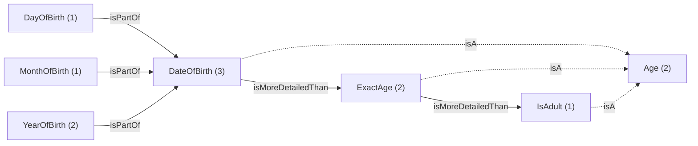

### Billing

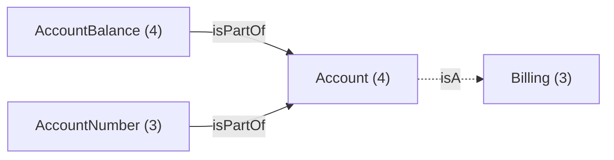

### Contact

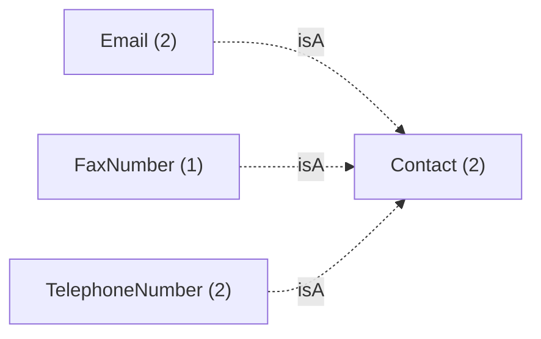

### Identity

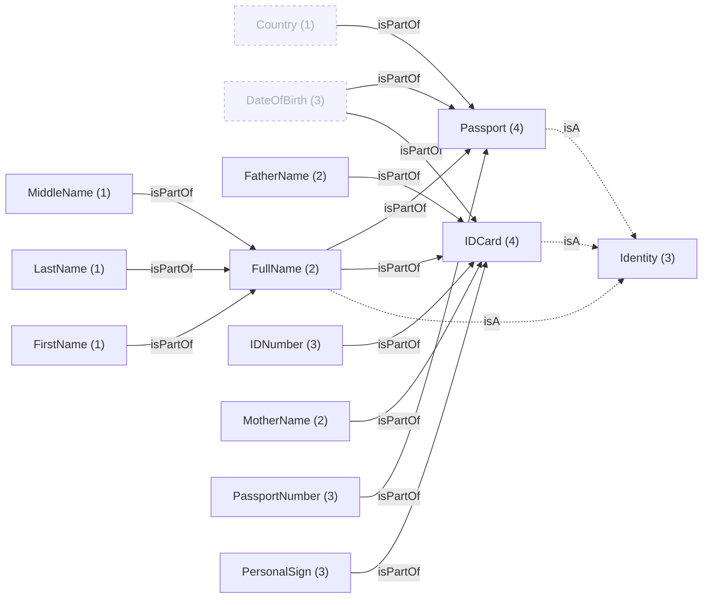

### Location

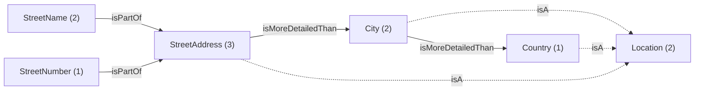

## Services

Each service is shown with its processing nodes (purpose in parentheses). Solid arrows: `requires`. Dashed arrows: `mayRequires`. Dotted arrows carry the condition under which a datum is required.

### AirportCheckIn

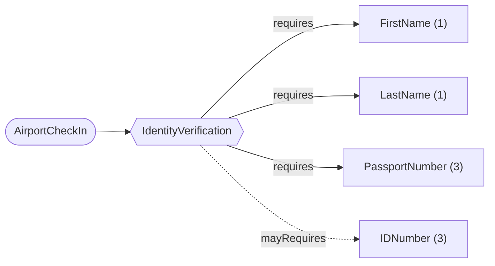

### CheckoutPay

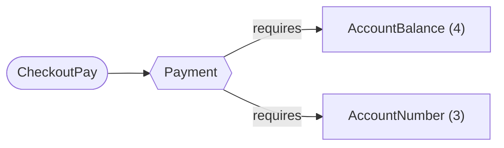

### CheckoutPayAdult

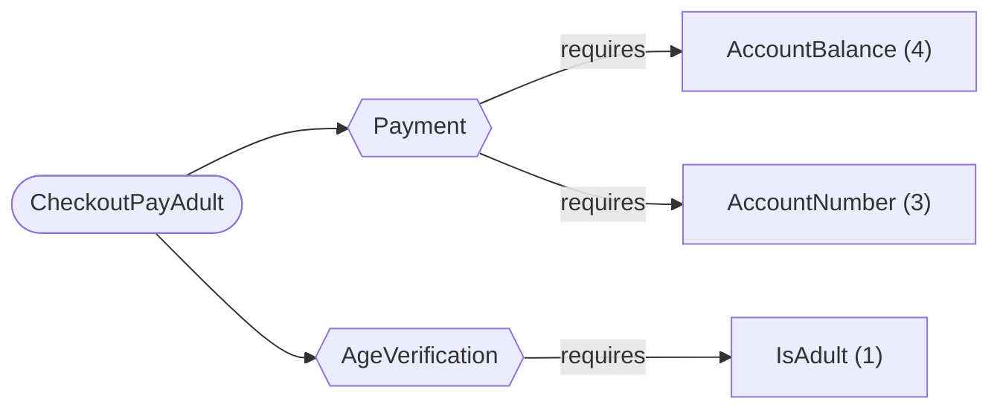

### EntryAllowance

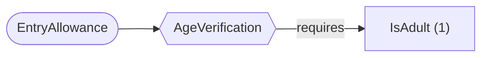

### LocalInfoFinder

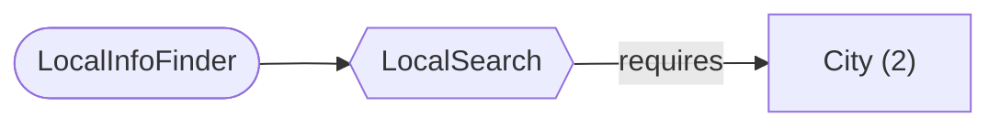

### MapProvision

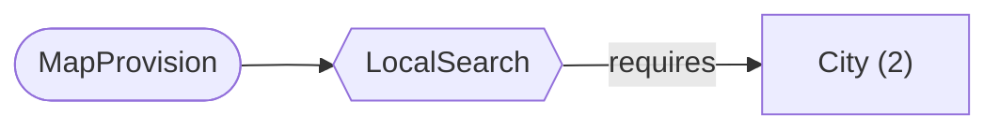

### OrderPlacement

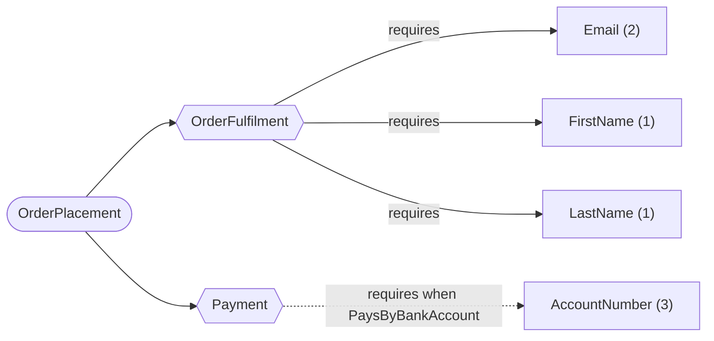

### PostalFormFilling

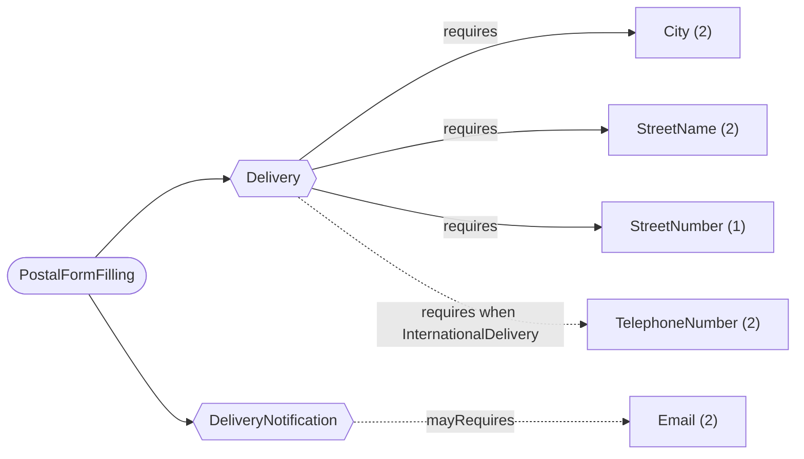

### RestaurantFinder

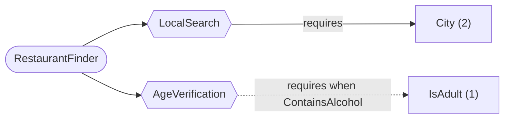

### ShopFinder

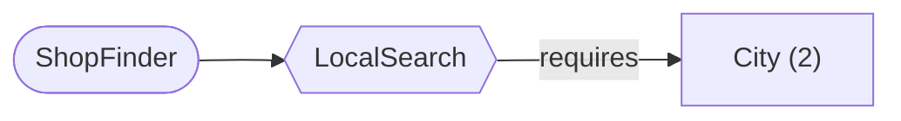

### SignInvoice

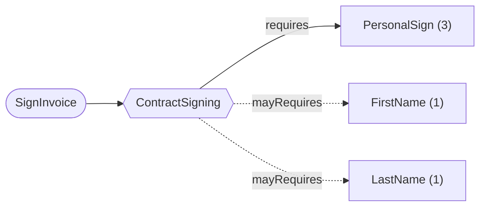

### SubscriptionPay

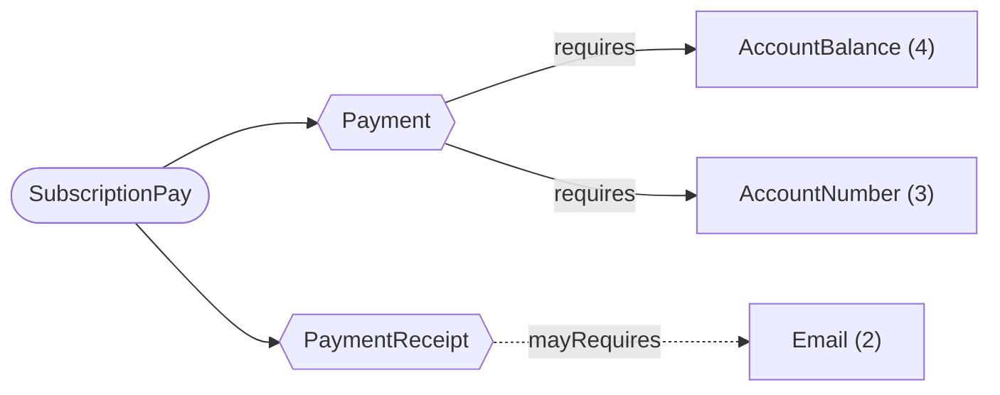

### SubscriptionSignUp

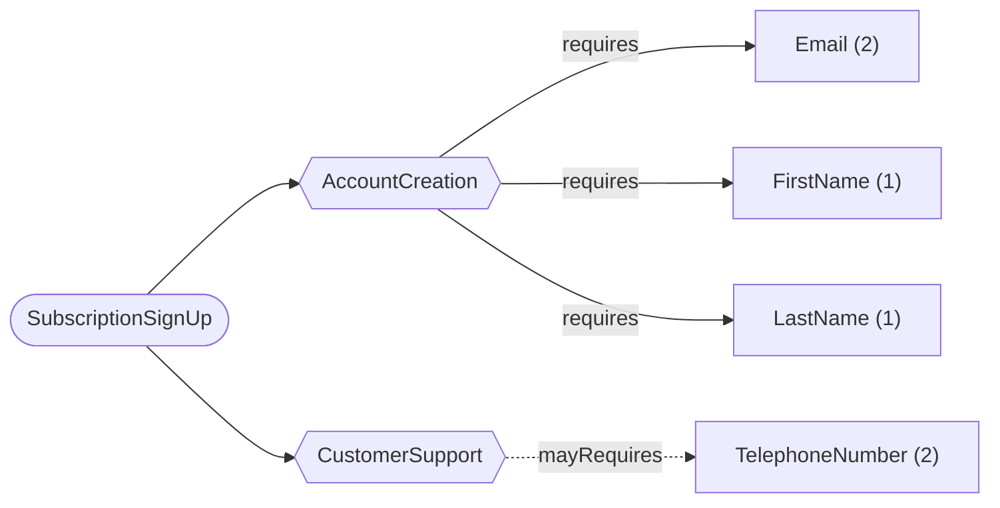

## DPV-PD mapping

| Data type | Sensitivity | DPV-PD concept |
|---|---|---|
| Account | 4 | `pd:BankAccount` |
| AccountBalance | 4 | - |
| AccountNumber | 3 | `pd:AccountIdentifier` |
| Age | 2 | `pd:Age` |
| Billing | 3 | `pd:Financial` |
| City | 2 | `pd:City` |
| Contact | 2 | `pd:Contact` |
| Country | 1 | `pd:Country` |
| DateOfBirth | 3 | `pd:BirthDate` |
| DayOfBirth | 1 | `pd:BirthDate` |
| Email | 2 | `pd:EmailAddress` |
| ExactAge | 2 | `pd:Age` |
| FatherName | 2 | - |
| FaxNumber | 1 | - |
| FirstName | 1 | `pd:Name` |
| FullName | 2 | `pd:Name` |
| IDCard | 4 | `pd:OfficialID` |
| IDNumber | 3 | `pd:OfficialID` |
| Identity | 3 | `pd:Identifying` |
| IsAdult | 1 | `pd:AgeRange` |
| LastName | 1 | `pd:Name` |
| Location | 2 | `pd:Location` |
| MiddleName | 1 | `pd:Name` |
| MonthOfBirth | 1 | `pd:BirthDate` |
| MotherName | 2 | - |
| Passport | 4 | `pd:Passport` |
| PassportNumber | 3 | `pd:Passport` |
| PersonalSign | 3 | - |
| StreetAddress | 3 | `pd:PhysicalAddress` |
| StreetName | 2 | `pd:Street` |
| StreetNumber | 1 | `pd:HouseNumber` |
| TelephoneNumber | 2 | `pd:TelephoneNumber` |
| YearOfBirth | 2 | `pd:BirthDate` |
